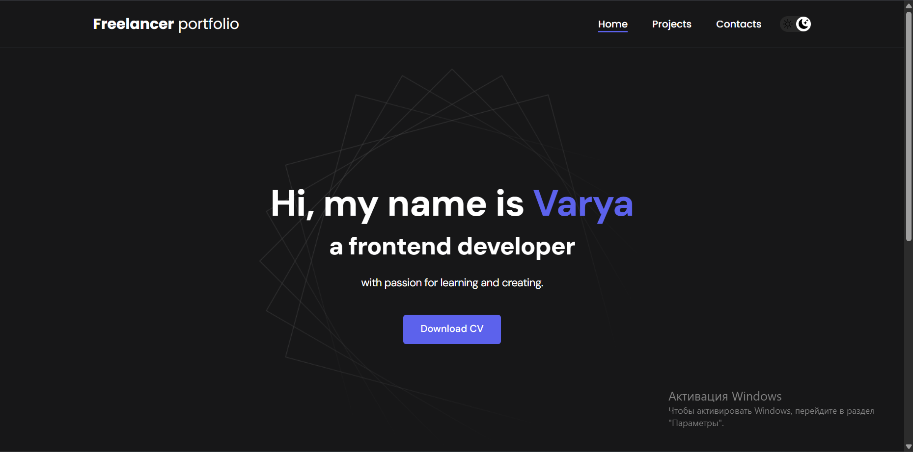
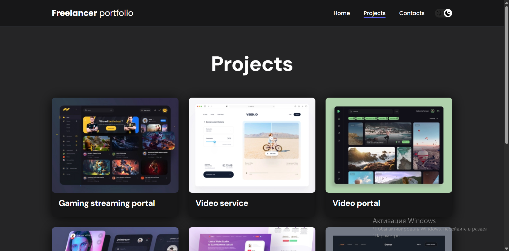
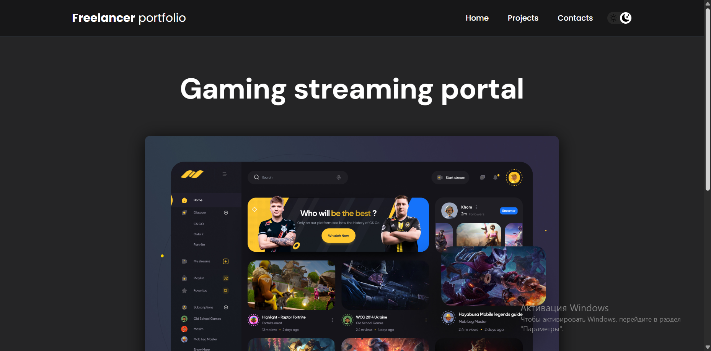

⚡ React Portfolio App

💼 Персональный портфолио-сайт с динамической навигацией, тёмной темой и отображением проектов.

📌 Overview

Этот проект — одностраничное приложение (SPA), разработанное с использованием React, демонстрирующее:
 масштабируемую архитектуру
 клиентский роутинг
 управление состоянием
 пользовательские хуки
 работу с браузерным API

✨ Features
 🧩 Модульная архитектура компонентов
 🌐 Client-side routing (React Router v6)
 🌙 Dark / Light mode
   сохранение в localStorage
   синхронизация с системной темой
 📂 Каталог проектов
 🔗 Интеграция с GitHub
 🔄 Scroll restoration при навигации
 ⚡ Оптимизированный рендеринг

🏗️ Tech Stack
 Core
   React 18
   JavaScript (ES6+)
 Routing
   react-router-dom v6
 State & Logic
   React Hooks:
    useState
    useEffect
    useRef
 Styling
   CSS (custom architecture)
   BEM-like naming
 Browser APIs
   localStorage
   matchMedia

🧠 Custom Logic
🔹 Dark Mode System
автоопределение темы:
window.matchMedia("(prefers-color-scheme: dark)")

сохранение состояния:
localStorage.setItem(...)

кастомный хук:
useLocalStorage
🔹 Scroll Restoration

При смене страницы:

window.scrollTo(0, 0)

Реализовано через useEffect + useLocation.

🚀 Getting Started
Установка
npm install

Запуск
npm start

Сборка
npm run build

📊 Performance
Проект использует:
reportWebVitals
lazy-friendly архитектуру
минимальные перерисовки через hooks
📸 Preview

Этот проект демонстрирует:

грамотную структуру React-приложения
работу с роутингом
управление состоянием
взаимодействие с browser API
написание кастомных хуков
организацию UI компонентов